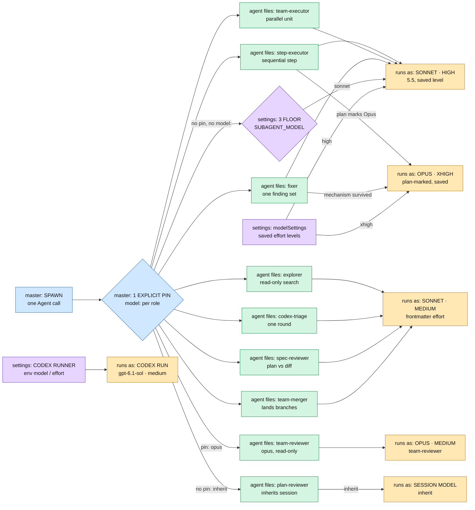
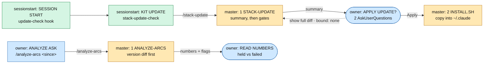

<!-- generated by tools/check.py export from spec/*.js — do not edit; regenerate with: python3 -B tools/check.py export -->

# Pipeline flow

Generated from the map specs: one flowchart and one decision table per view. Source links open the cited kit line at the commit the map is stamped with.

## feature pipeline

`feature` · kit `299e7d3`

Lanes: owner (blue) · master (green) · subagents (amber) · codex (violet)

```mermaid
flowchart LR
  classDef lane0 fill:#cfe8ff,stroke:#2b6cb0,color:#111
  classDef lane1 fill:#d5f5e3,stroke:#1e8449,color:#111
  classDef lane2 fill:#ffe8b3,stroke:#b7791f,color:#111
  classDef lane3 fill:#e8d5ff,stroke:#6b46c1,color:#111
  n0["owner: REQUEST<br/>feature ask"]:::lane0
  n1{"master: SIZE CALL<br/>which path?"}:::lane1
  n2["subagents: ONE-SHOT<br/>see view 3"]:::lane2
  n3(["owner: 1 DISCUSS<br/>2-3 options"]):::lane0
  n4["master: 2 PLAN<br/>plan mode"]:::lane1
  n5["subagents: explorer<br/>read-only search"]:::lane2
  n6["subagents: 3 VALIDATE<br/>plan-reviewer"]:::lane2
  n7{"master: DELEGATED?<br/>self-approval?"}:::lane1
  n8(["owner: TASTE Q<br/>≤4 questions"]):::lane0
  n9(["owner: 3 APPROVE<br/>ExitPlanMode"]):::lane0
  n10["master: PLAN → REPO<br/>sha · task list"]:::lane1
  n11["subagents: 4 EXECUTE<br/>step-executor ×N"]:::lane2
  n12["codex: STEP ROUND<br/>codex --pin"]:::lane3
  n13["subagents: codex-triage<br/>step verdict"]:::lane2
  n14{"master: STEP P0/P1?<br/>fix before next"}:::lane1
  n15["subagents: fixer<br/>step P0/P1"]:::lane2
  n16["master: FULL SUITE<br/>last step / cadence"]:::lane1
  n17["codex: 5 CHALLENGE<br/>whole range"]:::lane3
  n18["subagents: spec-reviewer<br/>plan vs diff"]:::lane2
  n19["subagents: codex-triage<br/>P0 / P1 / P2"]:::lane2
  n20{"master: P0 / P1 ?<br/>clean = 0 P0/P1"}:::lane1
  n21["subagents: fixer<br/>one finding set"]:::lane2
  n22(["owner: STRUCTURAL?<br/>fix #gt; the plan"]):::lane0
  n23(["owner: CONTRACT / R5<br/>out of the fix loop"]):::lane0
  n24(["owner: FIX OR DEFER<br/>standalone list"]):::lane0
  n25["master: INDEX LINE<br/>→ docs/reviews"]:::lane1
  n26["master: CLOSE-OUT<br/>suite again / cadence"]:::lane1
  n27(["owner: 6 PUSH<br/>owner approval"]):::lane0
  n28["master: PR → MERGE<br/>+ deploy"]:::lane1
  n29["master: VERIFY<br/>post-deploy"]:::lane1
  n0 --> n1
  n1 -- "pipeline" --> n3
  n1 -- "one-shot" --> n2
  n3 -- "pick" --> n4
  n4 --> n5
  n5 --> n4
  n4 --> n6
  n6 -. "blocking: revise · bound: ≤2 review passes" .-> n4
  n6 --> n7
  n7 -- "no" --> n8
  n7 --> n10
  n8 --> n9
  n9 -. "keep planning · bound: none" .-> n4
  n9 -- "approve" --> n10
  n10 --> n11
  n11 -- "last step: no round" --> n16
  n14 -. "next step · bound: ≤5 steps per arc" .-> n11
  n11 -- "--pin" --> n12
  n12 --> n13
  n13 --> n14
  n14 -- "P0/P1" --> n15
  n15 -. "then next step · bound: ≤5 steps per arc" .-> n11
  n16 --> n18
  n16 --> n17
  n18 --> n20
  n17 --> n19
  n19 --> n20
  n20 -- "clean" --> n24
  n20 -- "contract / check-in" --> n23
  n20 --> n22
  n20 -- "owner-deferred P1" --> n25
  n20 -- "each round's P0/P1" --> n21
  n22 --> n21
  n21 -. "re-challenge · bound: owner check-in at round 5 and every fifth round after it" .-> n17
  n23 --> n24
  n23 -. "continue · bound: owner check-in at round 5 and every fifth round after it" .-> n21
  n23 -- "defer to own arc · #91;P0 blocks ship#93;" --> n25
  n24 --> n25
  n24 -- "none / fixed" --> n26
  n24 -- "fix now" --> n21
  n25 --> n26
  n26 --> n27
  n27 -- "approved" --> n28
  n28 --> n29
```

### Decisions — feature pipeline

| Decision | View | SDLC phase | Who decides | Inputs | Options | Enforced by | Evidence | Source |
|---|---|---|---|---|---|---|---|---|
| SIZE CALL — which path? | feature pipeline | INTAKE | master | request, exploration facts | 1. pipeline 2. one-shot | analyze-arcs | the call line in the transcript, before the first edit and the feature-workflow load | [global/CLAUDE.md:55](https://github.com/TurboKach/claude-code-setup/blob/299e7d3/global/CLAUDE.md?plain=1#L55) [global/CLAUDE.md:57](https://github.com/TurboKach/claude-code-setup/blob/299e7d3/global/CLAUDE.md?plain=1#L57) [global/CLAUDE.md:52](https://github.com/TurboKach/claude-code-setup/blob/299e7d3/global/CLAUDE.md?plain=1#L52) [skills/analyze-arcs/scripts/analyze.py:610](https://github.com/TurboKach/claude-code-setup/blob/299e7d3/skills/analyze-arcs/scripts/analyze.py?plain=1#L610) |
| 1 DISCUSS — 2-3 options | feature pipeline | INTAKE | owner + master | sized request, research summary | 1. pick one option 2. push back / ask for more research 3. not worth building | 1. prose 2. prose | 1. the owner's answer to the option-pick 2. none | [skills/feature-workflow/SKILL.md:14](https://github.com/TurboKach/claude-code-setup/blob/299e7d3/skills/feature-workflow/SKILL.md?plain=1#L14) [global/CLAUDE.md:5](https://github.com/TurboKach/claude-code-setup/blob/299e7d3/global/CLAUDE.md?plain=1#L5) [global/CLAUDE.md:4](https://github.com/TurboKach/claude-code-setup/blob/299e7d3/global/CLAUDE.md?plain=1#L4) [global/CLAUDE.md:29](https://github.com/TurboKach/claude-code-setup/blob/299e7d3/global/CLAUDE.md?plain=1#L29) [global/CLAUDE.md:43](https://github.com/TurboKach/claude-code-setup/blob/299e7d3/global/CLAUDE.md?plain=1#L43) |
| DELEGATED? — self-approval? | feature pipeline | DESIGN REVIEW | master | reviewed plan, owner instruction | 1. no 2. PLAN → REPO | 1. prose 2. harness 3. prose | 1. the delegation recorded in the plan file 2. the owner's ExitPlanMode approval 3. the owner's own message, quoted in the turn | [global/CLAUDE.md:29](https://github.com/TurboKach/claude-code-setup/blob/299e7d3/global/CLAUDE.md?plain=1#L29) [skills/feature-workflow/SKILL.md:20](https://github.com/TurboKach/claude-code-setup/blob/299e7d3/skills/feature-workflow/SKILL.md?plain=1#L20) |
| TASTE Q — ≤4 questions | feature pipeline | DESIGN REVIEW | owner | taste / open-decisions list | 1. the recommended option 2. the simplest option (remove it / do nothing) | 1. harness 2. prose 3. prose | 1. the owner's AskUserQuestion answers, edited into the plan file 2. none 3. the question sits in the thread reply and the turn has ended | [global/CLAUDE.md:63](https://github.com/TurboKach/claude-code-setup/blob/299e7d3/global/CLAUDE.md?plain=1#L63) [skills/feature-workflow/SKILL.md:20](https://github.com/TurboKach/claude-code-setup/blob/299e7d3/skills/feature-workflow/SKILL.md?plain=1#L20) [global/CLAUDE.md:29](https://github.com/TurboKach/claude-code-setup/blob/299e7d3/global/CLAUDE.md?plain=1#L29) |
| 3 APPROVE — ExitPlanMode | feature pipeline | DESIGN REVIEW | owner | plan file, advisory findings | 1. approve 2. keep planning (feedback) | 1. harness 2. harness 3. prose 4. prose | 1. the owner's ExitPlanMode approval 2. none 3. none 4. the owner's own message, quoted in the turn | [skills/feature-workflow/SKILL.md:20](https://github.com/TurboKach/claude-code-setup/blob/299e7d3/skills/feature-workflow/SKILL.md?plain=1#L20) [global/CLAUDE.md:29](https://github.com/TurboKach/claude-code-setup/blob/299e7d3/global/CLAUDE.md?plain=1#L29) [skills/feature-workflow/SKILL.md:81](https://github.com/TurboKach/claude-code-setup/blob/299e7d3/skills/feature-workflow/SKILL.md?plain=1#L81) [global/CLAUDE.md:30](https://github.com/TurboKach/claude-code-setup/blob/299e7d3/global/CLAUDE.md?plain=1#L30) |
| STEP P0/P1? — fix before next | feature pipeline | BUILD | master | step verdict, task list (addBlockedBy) | 1. next step · bound: ≤5 steps per arc 2. P0/P1 | prose | the blocking steps' verdicts with zero open P0/P1, or the fixer's red-then-green report | [skills/feature-workflow/SKILL.md:37](https://github.com/TurboKach/claude-code-setup/blob/299e7d3/skills/feature-workflow/SKILL.md?plain=1#L37) |
| P0 / P1 ? — clean = 0 P0/P1 | feature pipeline | REVIEW | master | triaged verdict, spec-reviewer gaps | 1. clean 2. contract / check-in 3. STRUCTURAL? 4. owner-deferred P1 5. each round's P0/P1 | 1. prose 2. prose 3. prose | 1. a triaged verdict with zero P0/P1 lines, counts recomputed by the master 2. the master's recomputed counts 3. the round's report names the mechanism | [skills/feature-workflow/SKILL.md:54](https://github.com/TurboKach/claude-code-setup/blob/299e7d3/skills/feature-workflow/SKILL.md?plain=1#L54) [skills/feature-workflow/SKILL.md:110](https://github.com/TurboKach/claude-code-setup/blob/299e7d3/skills/feature-workflow/SKILL.md?plain=1#L110) [skills/feature-workflow/SKILL.md:109](https://github.com/TurboKach/claude-code-setup/blob/299e7d3/skills/feature-workflow/SKILL.md?plain=1#L109) |
| STRUCTURAL? — fix &gt; the plan | feature pipeline | REVIEW | owner | mechanism finding set | 1. structural fix 2. patch this path and carry the rest | 1. prose 2. prose | 1. the owner's answer 2. the question sits in the thread reply and the turn has ended | [skills/feature-workflow/SKILL.md:62](https://github.com/TurboKach/claude-code-setup/blob/299e7d3/skills/feature-workflow/SKILL.md?plain=1#L62) [skills/feature-workflow/SKILL.md:109](https://github.com/TurboKach/claude-code-setup/blob/299e7d3/skills/feature-workflow/SKILL.md?plain=1#L109) [global/CLAUDE.md:29](https://github.com/TurboKach/claude-code-setup/blob/299e7d3/global/CLAUDE.md?plain=1#L29) |
| CONTRACT / R5 — out of the fix loop | feature pipeline | REVIEW | owner | contract-touching finding, P0/P1 still in the loop at round 5, 10, ... | 1. contract: defer to its own arc 2. contract: ship as-is 3. check-in: continue the loop 4. check-in: take P0/P1 out (own arc) | 1. prose 2. prose 3. prose | 1. the owner's answer 2. the owner's answer 3. the question sits in the thread reply and the turn has ended | [skills/feature-workflow/SKILL.md:60](https://github.com/TurboKach/claude-code-setup/blob/299e7d3/skills/feature-workflow/SKILL.md?plain=1#L60) [skills/feature-workflow/SKILL.md:58](https://github.com/TurboKach/claude-code-setup/blob/299e7d3/skills/feature-workflow/SKILL.md?plain=1#L58) [global/CLAUDE.md:29](https://github.com/TurboKach/claude-code-setup/blob/299e7d3/global/CLAUDE.md?plain=1#L29) |
| FIX OR DEFER — standalone list | feature pipeline | REVIEW | owner | every round's verdict file | 1. fix now (one fixer for the set) 2. defer to the tech-debt file 3. let me pick | 1. prose 2. prose | 1. the owner's answer 2. the question sits in the thread reply and the turn has ended | [skills/feature-workflow/SKILL.md:64](https://github.com/TurboKach/claude-code-setup/blob/299e7d3/skills/feature-workflow/SKILL.md?plain=1#L64) [global/CLAUDE.md:29](https://github.com/TurboKach/claude-code-setup/blob/299e7d3/global/CLAUDE.md?plain=1#L29) |
| 6 PUSH — owner approval | feature pipeline | RELEASE | owner | clean verdict, unpushed-commit count, deferred P1 names | 1. push 2. hold: the work stays local | 1. prose 2. prose 3. prose 4. prose | 1. the owner's explicit approval in the session 2. the shown codex-triage verdict 3. git diff --stat &lt;reviewed-head&gt;..HEAD, shown in the push ask 4. the owner's own message, quoted in the turn | [global/CLAUDE.md:26](https://github.com/TurboKach/claude-code-setup/blob/299e7d3/global/CLAUDE.md?plain=1#L26) [global/CLAUDE.md:27](https://github.com/TurboKach/claude-code-setup/blob/299e7d3/global/CLAUDE.md?plain=1#L27) [global/CLAUDE.md:29](https://github.com/TurboKach/claude-code-setup/blob/299e7d3/global/CLAUDE.md?plain=1#L29) |

## recovery &amp; limits

`recovery` · kit `299e7d3`

Lanes: owner (blue) · harness (green) · master (amber) · subagents (violet) · codex (rose)

```mermaid
flowchart LR
  classDef lane0 fill:#cfe8ff,stroke:#2b6cb0,color:#111
  classDef lane1 fill:#d5f5e3,stroke:#1e8449,color:#111
  classDef lane2 fill:#ffe8b3,stroke:#b7791f,color:#111
  classDef lane3 fill:#e8d5ff,stroke:#6b46c1,color:#111
  classDef lane4 fill:#ffd6dc,stroke:#c53030,color:#111
  n0["harness: WATCHDOG CRON<br/>7,22,37,52 * * * *"]:::lane1
  n1{"master: QUIET AGENT?<br/>10 min, no write"}:::lane2
  n2["harness: API ERROR<br/>agent ends early"]:::lane1
  n3["master: READ TRANSCRIPT<br/>subagents/*.jsonl"]:::lane2
  n4["subagents: FRESH AGENT<br/>remainder only"]:::lane3
  n5["owner: PARK<br/>notify, end turn"]:::lane0
  n6["harness: maxTurns CAP<br/>result partial"]:::lane1
  n7["master: WIP + RESUME<br/>SendMessage"]:::lane2
  n8["subagents: RESUMED AGENT<br/>full history"]:::lane3
  n9["master: CODEX LAUNCH<br/>background Bash"]:::lane2
  n10["codex: CODEX RUN<br/>3 tries, 15-min cap"]:::lane4
  n11{"master: EXIT CODE?<br/>+ elapsed secs"}:::lane2
  n12["master: RELAUNCH ONCE<br/>on 124, -r2 --out"]:::lane2
  n13["master: ROUND SKIPPED<br/>step: 2nd 124 / fail"]:::lane2
  n14["master: SPLIT RANGE<br/>stage 5, 2nd 124"]:::lane2
  n15["codex: SLICES<br/>concurrent, no pin"]:::lane4
  n16["subagents: codex-triage<br/>all files, 1 spawn"]:::lane3
  n17["master: PLAN DRAFT<br/>steps · files"]:::lane2
  n18{"master: ARC SPLIT?<br/>#gt;5 steps/40+ files"}:::lane2
  n19["owner: DEVICE PASS<br/>between the arcs"]:::lane0
  n20["harness: CONTEXT SIZE<br/>master tokens"]:::lane1
  n21["harness: COMPACTION<br/>auto or manual"]:::lane1
  n22["master: RELOAD SKILL<br/>feature-workflow"]:::lane2
  n23["master: HANDOFF BRIEF<br/>scratchpad/handoff"]:::lane2
  n24["owner: NEW SESSION<br/>owner pastes brief"]:::lane0
  n25["harness: --bg SESSION<br/>same name, auto"]:::lane1
  n26["master: NEW MASTER<br/>next arc"]:::lane2
  n0 --> n1
  n1 --> n3
  n4 -. "dies again · bound: ≤2 respawns" .-> n3
  n2 --> n3
  n3 --> n4
  n3 -- "after 2 respawns" --> n5
  n8 -. "caps again · bound: none" .-> n3
  n6 --> n7
  n7 -- "SendMessage" --> n8
  n9 --> n10
  n10 --> n11
  n11 -- "66 · stage 5 fail ×3" --> n5
  n11 -- "124 again · stage 5" --> n14
  n11 -- "step: 2nd 124 · fail ×3" --> n13
  n11 --> n12
  n12 -. "same args · bound: once" .-> n10
  n11 -- "exit 0" --> n16
  n14 --> n15
  n15 --> n16
  n16 -- "stage 5: #lt;60 s, empty" --> n5
  n16 -- "per-step: #lt;60 s, empty" --> n13
  n5 -. "reset time named · bound: one relaunch" .-> n9
  n17 --> n18
  n18 -- "two arcs" --> n19
  n19 -- "arc 2 next" --> n23
  n20 -- "~500k: hand off" --> n23
  n21 --> n22
  n23 -- "attended" --> n24
  n23 -- "unattended" --> n25
  n25 --> n26
  n24 --> n26
```

### Decisions — recovery &amp; limits

| Decision | View | SDLC phase | Who decides | Inputs | Options | Enforced by | Evidence | Source |
|---|---|---|---|---|---|---|---|---|
| QUIET AGENT? — 10 min, no write | recovery &amp; limits | — | master (cron prompt) | subagents/\*.jsonl mtimes | READ TRANSCRIPT | 1. prose 2. prose | 1. the transcript mtime in subagents/\*.jsonl 2. none | [global/CLAUDE.md:39](https://github.com/TurboKach/claude-code-setup/blob/299e7d3/global/CLAUDE.md?plain=1#L39) |
| EXIT CODE? — + elapsed secs | recovery &amp; limits | — | master | exit code, elapsed seconds | 1. 66 · stage 5 fail ×3 2. 124 again · stage 5 3. step: 2nd 124 · fail ×3 4. RELAUNCH ONCE 5. exit 0 | 1. prose 2. prose 3. prose | 1. a second run under an -r2 --out name 2. none 3. none | [skills/feature-workflow/SKILL.md:72](https://github.com/TurboKach/claude-code-setup/blob/299e7d3/skills/feature-workflow/SKILL.md?plain=1#L72) |
| ARC SPLIT? — &gt;5 steps/40+ files | recovery &amp; limits | — | master; plan-reviewer blocks | step count, file count | two arcs | prose | plan-reviewer reports blocking=0 | [skills/feature-workflow/SKILL.md:17](https://github.com/TurboKach/claude-code-setup/blob/299e7d3/skills/feature-workflow/SKILL.md?plain=1#L17) [agents/plan-reviewer.md:19](https://github.com/TurboKach/claude-code-setup/blob/299e7d3/agents/plan-reviewer.md?plain=1#L19) |

## one-shot path

`oneshot` · kit `299e7d3`

Lanes: owner (blue) · master (green) · subagents (amber) · codex (violet)

```mermaid
flowchart LR
  classDef lane0 fill:#cfe8ff,stroke:#2b6cb0,color:#111
  classDef lane1 fill:#d5f5e3,stroke:#1e8449,color:#111
  classDef lane2 fill:#ffe8b3,stroke:#b7791f,color:#111
  classDef lane3 fill:#e8d5ff,stroke:#6b46c1,color:#111
  n0["owner: REQUEST<br/>small, clear ask"]:::lane0
  n1{"master: SIZE CALL<br/>one-shot?"}:::lane1
  n2(["owner: ASK: ONE LINE<br/>path in doubt"]):::lane0
  n3["subagents: PIPELINE<br/>see view 1"]:::lane2
  n4{"master: TRIVIAL?<br/>inline or spawn"}:::lane1
  n5["master: INLINE EDIT<br/>master, trivial"]:::lane1
  n6["subagents: step-executor<br/>one spawn"]:::lane2
  n7["master: LAUNCH CODEX<br/>background Bash"]:::lane1
  n8["codex: ONE-SHOT ROUND<br/>codex-challenge.sh"]:::lane3
  n9["subagents: codex-triage<br/>one spawn on the file"]:::lane2
  n10{"master: P0 / P1 ?<br/>clean = 0 P0/P1"}:::lane1
  n11["subagents: fixer<br/>each round's P0/P1"]:::lane2
  n12["master: DONE<br/>cross-review ran"]:::lane1
  n13(["owner: 6 PUSH<br/>owner approval"]):::lane0
  n0 --> n1
  n1 -- "in doubt" --> n2
  n1 -- "pipeline" --> n3
  n2 --> n3
  n2 -- "one-shot" --> n4
  n1 --> n4
  n4 --> n5
  n4 -- "else" --> n6
  n5 --> n7
  n6 --> n7
  n7 -- "sha..HEAD" --> n8
  n8 --> n9
  n9 --> n10
  n10 -- "each round's P0/P1" --> n11
  n11 -. "re-challenge · bound: owner check-in at round 5 and every fifth round after it" .-> n8
  n10 -- "clean" --> n12
  n12 --> n13
```

### Decisions — one-shot path

| Decision | View | SDLC phase | Who decides | Inputs | Options | Enforced by | Evidence | Source |
|---|---|---|---|---|---|---|---|---|
| SIZE CALL — one-shot? | one-shot path | — | master | request, exploration facts | 1. in doubt 2. pipeline 3. TRIVIAL? | 1. analyze-arcs 2. prose | 1. no 'product edits without a one-shot/pipeline call line' flag in the arc report 2. the call line names the sizing facts | [global/CLAUDE.md:54](https://github.com/TurboKach/claude-code-setup/blob/299e7d3/global/CLAUDE.md?plain=1#L54) [global/CLAUDE.md:52](https://github.com/TurboKach/claude-code-setup/blob/299e7d3/global/CLAUDE.md?plain=1#L52) [skills/analyze-arcs/scripts/analyze.py:611](https://github.com/TurboKach/claude-code-setup/blob/299e7d3/skills/analyze-arcs/scripts/analyze.py?plain=1#L611) |
| ASK: ONE LINE — path in doubt | one-shot path | — | owner + master | call line in doubt | 1. one-shot 2. pipeline | prose | the owner's answer to the one-line question | [global/CLAUDE.md:57](https://github.com/TurboKach/claude-code-setup/blob/299e7d3/global/CLAUDE.md?plain=1#L57) |
| TRIVIAL? — inline or spawn | one-shot path | — | master | call line: one-shot | 1. INLINE EDIT 2. else | prose | none | [global/CLAUDE.md:54](https://github.com/TurboKach/claude-code-setup/blob/299e7d3/global/CLAUDE.md?plain=1#L54) |
| P0 / P1 ? — clean = 0 P0/P1 | one-shot path | — | master | triaged verdict | 1. each round's P0/P1 2. clean | 1. prose 2. prose | 1. a triaged verdict with zero P0/P1 lines, counts recomputed by the master 2. the master's recomputed counts | [global/CLAUDE.md:54](https://github.com/TurboKach/claude-code-setup/blob/299e7d3/global/CLAUDE.md?plain=1#L54) [skills/feature-workflow/SKILL.md:54](https://github.com/TurboKach/claude-code-setup/blob/299e7d3/skills/feature-workflow/SKILL.md?plain=1#L54) [skills/feature-workflow/SKILL.md:110](https://github.com/TurboKach/claude-code-setup/blob/299e7d3/skills/feature-workflow/SKILL.md?plain=1#L110) |
| 6 PUSH — owner approval | one-shot path | — | owner | clean verdict, unpushed-commit count, deferred P1 names | 1. push 2. hold: the work stays local | 1. prose 2. prose 3. prose 4. prose | 1. the owner's explicit approval in the session 2. the shown codex-triage verdict 3. git diff --stat &lt;reviewed-head&gt;..HEAD, shown in the push ask 4. the owner's own message, quoted in the turn | [global/CLAUDE.md:26](https://github.com/TurboKach/claude-code-setup/blob/299e7d3/global/CLAUDE.md?plain=1#L26) [global/CLAUDE.md:27](https://github.com/TurboKach/claude-code-setup/blob/299e7d3/global/CLAUDE.md?plain=1#L27) [global/CLAUDE.md:29](https://github.com/TurboKach/claude-code-setup/blob/299e7d3/global/CLAUDE.md?plain=1#L29) |

## parallel fan-out

`fanout` · kit `299e7d3`

Lanes: owner (blue) · master (green) · subagents (amber) · worktrees (violet) · codex (rose)

```mermaid
flowchart LR
  classDef lane0 fill:#cfe8ff,stroke:#2b6cb0,color:#111
  classDef lane1 fill:#d5f5e3,stroke:#1e8449,color:#111
  classDef lane2 fill:#ffe8b3,stroke:#b7791f,color:#111
  classDef lane3 fill:#e8d5ff,stroke:#6b46c1,color:#111
  classDef lane4 fill:#ffd6dc,stroke:#c53030,color:#111
  n0["owner: TASK<br/>outside a pipeline"]:::lane0
  n1(["owner: ASK: FAN OUT?<br/>outside a pipeline"]):::lane0
  n2(["owner: PLAN ONLY<br/>ExitPlanMode"]):::lane0
  n3["master: PLAN<br/>Parallel: line"]:::lane1
  n4{"master: PARALLEL?<br/>at most two writers"}:::lane1
  n5["subagents: SEQUENTIAL<br/>step-executor"]:::lane2
  n6{"master: MECHANISM<br/>subagents/Workflows"}:::lane1
  n7["subagents: WORKFLOWS<br/>script fan-out"]:::lane2
  n8["master: SPAWN<br/>unnamed, one turn"]:::lane1
  n9["worktrees: team-executor A<br/>own worktree"]:::lane3
  n10["worktrees: team-executor B<br/>own worktree"]:::lane3
  n11["subagents: team-reviewer<br/>agent-teams only"]:::lane2
  n12["subagents: team-merger<br/>lands the branches"]:::lane2
  n13{"master: LANDED CLEAN?<br/>stage-4 pair"}:::lane1
  n14["subagents: step-executor<br/>finishes the unit"]:::lane2
  n15["subagents: fixer<br/>conflict / red build"]:::lane2
  n16["codex: STEP ROUND<br/>merged range, --pin"]:::lane4
  n17["subagents: codex-triage<br/>verdict"]:::lane2
  n18{"master: SETS DISJOINT?<br/>fixer pair rule"}:::lane1
  n19["subagents: fixer<br/>serial (default)"]:::lane2
  n20["codex: CODEX GATE<br/>merged feature diff"]:::lane4
  n0 --> n1
  n1 -- "fan out" --> n6
  n6 -- "Workflows" --> n7
  n6 -- "subagents" --> n2
  n2 -- "approved" --> n8
  n3 --> n4
  n4 -- "none" --> n5
  n4 --> n8
  n8 --> n9
  n8 --> n10
  n9 -- "agent-teams" --> n11
  n10 --> n11
  n9 -- "pair: no reviewer" --> n12
  n10 --> n12
  n11 --> n12
  n12 -- "pair" --> n13
  n12 -- "agent-teams: all landed" --> n20
  n13 -- "stopped short" --> n14
  n13 -- "conflict / red" --> n15
  n13 --> n16
  n14 --> n16
  n15 --> n16
  n16 --> n17
  n20 --> n17
  n17 -- "P0/P1 sets" --> n18
  n18 -- "serial (default)" --> n19
  n18 -. "disjoint: a pair · bound: a pair at most, never wider" .-> n4
```

### Decisions — parallel fan-out

| Decision | View | SDLC phase | Who decides | Inputs | Options | Enforced by | Evidence | Source |
|---|---|---|---|---|---|---|---|---|
| ASK: FAN OUT? — outside a pipeline | parallel fan-out | — | owner + master | task with parallel parts | 1. fan out in parallel 2. no: one agent, sequential | prose | the owner's answer to the fan-out question | [skills/feature-workflow/SKILL.md:96](https://github.com/TurboKach/claude-code-setup/blob/299e7d3/skills/feature-workflow/SKILL.md?plain=1#L96) |
| PLAN ONLY — ExitPlanMode | parallel fan-out | — | owner | plan file, plan-reviewer findings | 1. approve 2. keep planning (feedback) | 1. harness 2. harness 3. prose 4. prose 5. prose 6. prose | 1. the owner's ExitPlanMode approval; the plan file copied to docs/prompts/&lt;feature&gt;-plan.md and committed 2. none 3. the owner's answers, edited into the plan 4. none 5. the question sits in the thread reply and the turn has ended 6. the owner's own message, quoted in the turn | [skills/agent-teams/SKILL.md:156](https://github.com/TurboKach/claude-code-setup/blob/299e7d3/skills/agent-teams/SKILL.md?plain=1#L156) [skills/agent-teams/SKILL.md:158](https://github.com/TurboKach/claude-code-setup/blob/299e7d3/skills/agent-teams/SKILL.md?plain=1#L158) [skills/agent-teams/SKILL.md:124](https://github.com/TurboKach/claude-code-setup/blob/299e7d3/skills/agent-teams/SKILL.md?plain=1#L124) [skills/agent-teams/SKILL.md:150](https://github.com/TurboKach/claude-code-setup/blob/299e7d3/skills/agent-teams/SKILL.md?plain=1#L150) [skills/agent-teams/SKILL.md:160](https://github.com/TurboKach/claude-code-setup/blob/299e7d3/skills/agent-teams/SKILL.md?plain=1#L160) [skills/agent-teams/SKILL.md:162](https://github.com/TurboKach/claude-code-setup/blob/299e7d3/skills/agent-teams/SKILL.md?plain=1#L162) [global/CLAUDE.md:29](https://github.com/TurboKach/claude-code-setup/blob/299e7d3/global/CLAUDE.md?plain=1#L29) |
| PARALLEL? — at most two writers | parallel fan-out | — | master (plan stage) | drafted steps, explorer's runtime facts | 1. none 2. SPAWN | 1. prose 2. prose 3. prose 4. prose 5. prose 6. prose | 1. the plan's Parallel: line 2. plan-reviewer reports blocking=0 3. plan-reviewer reports blocking=0 4. none 5. explorer's runtime facts, or the project's CLAUDE.md record 6. the costs named in the Parallel: line | [skills/feature-workflow/SKILL.md:19](https://github.com/TurboKach/claude-code-setup/blob/299e7d3/skills/feature-workflow/SKILL.md?plain=1#L19) [agents/plan-reviewer.md:23](https://github.com/TurboKach/claude-code-setup/blob/299e7d3/agents/plan-reviewer.md?plain=1#L23) |
| MECHANISM — subagents/Workflows | parallel fan-out | — | master (lead) | fan-out answer | 1. Workflows 2. subagents | prose | none | [skills/agent-teams/SKILL.md:29](https://github.com/TurboKach/claude-code-setup/blob/299e7d3/skills/agent-teams/SKILL.md?plain=1#L29) [skills/agent-teams/SKILL.md:34](https://github.com/TurboKach/claude-code-setup/blob/299e7d3/skills/agent-teams/SKILL.md?plain=1#L34) [skills/agent-teams/SKILL.md:43](https://github.com/TurboKach/claude-code-setup/blob/299e7d3/skills/agent-teams/SKILL.md?plain=1#L43) |
| LANDED CLEAN? — stage-4 pair | parallel fan-out | — | master | merger report | 1. stopped short 2. conflict / red 3. STEP ROUND | 1. prose 2. prose | 1. a WIP: commit on the session branch 2. the merger's build and suite counts (executed/skipped/failed), green | [skills/feature-workflow/SKILL.md:21](https://github.com/TurboKach/claude-code-setup/blob/299e7d3/skills/feature-workflow/SKILL.md?plain=1#L21) |
| SETS DISJOINT? — fixer pair rule | parallel fan-out | — | master | finding sets | 1. serial (default) 2. disjoint: a pair · bound: a pair at most, never wider | 1. prose 2. prose | 1. none 2. none | [skills/feature-workflow/SKILL.md:108](https://github.com/TurboKach/claude-code-setup/blob/299e7d3/skills/feature-workflow/SKILL.md?plain=1#L108) |

## model / effort routing

`routing` · kit `299e7d3`

Lanes: master (blue) · agent files (green) · runs as (amber) · settings (violet)

### Decisions — model / effort routing

| Decision | View | SDLC phase | Who decides | Inputs | Options | Enforced by | Evidence | Source |
|---|---|---|---|---|---|---|---|---|
| 1 EXPLICIT PIN — model: per role | model / effort routing | — | master | subagent\_type, the plan's Opus marks | 1. step-executor 2. team-executor 3. fixer 4. explorer 5. codex-triage 6. spec-reviewer 7. team-merger 8. pin: opus 9. no pin: inherit 10. no pin, no model: | 1. analyze-arcs 2. analyze-arcs 3. analyze-arcs 4. prose 5. prose 6. prose | 1. no 'unpinned spawn' or 'pinned X (doctrine Y)' flag in the arc report 2. no 'plan-reviewer pinned … (doctrine: inherit)' flag in the arc report 3. the arc report's 'fixer pinned opus' flag ends in '— reason stated' 4. none 5. none 6. none | [global/CLAUDE.md:39](https://github.com/TurboKach/claude-code-setup/blob/299e7d3/global/CLAUDE.md?plain=1#L39) [skills/analyze-arcs/scripts/analyze.py:12](https://github.com/TurboKach/claude-code-setup/blob/299e7d3/skills/analyze-arcs/scripts/analyze.py?plain=1#L12) [skills/analyze-arcs/scripts/analyze.py:618](https://github.com/TurboKach/claude-code-setup/blob/299e7d3/skills/analyze-arcs/scripts/analyze.py?plain=1#L618) [skills/feature-workflow/SKILL.md:20](https://github.com/TurboKach/claude-code-setup/blob/299e7d3/skills/feature-workflow/SKILL.md?plain=1#L20) [skills/analyze-arcs/scripts/analyze.py:617](https://github.com/TurboKach/claude-code-setup/blob/299e7d3/skills/analyze-arcs/scripts/analyze.py?plain=1#L617) [skills/feature-workflow/SKILL.md:109](https://github.com/TurboKach/claude-code-setup/blob/299e7d3/skills/feature-workflow/SKILL.md?plain=1#L109) [skills/analyze-arcs/scripts/analyze.py:621](https://github.com/TurboKach/claude-code-setup/blob/299e7d3/skills/analyze-arcs/scripts/analyze.py?plain=1#L621) [skills/analyze-arcs/scripts/analyze.py:528](https://github.com/TurboKach/claude-code-setup/blob/299e7d3/skills/analyze-arcs/scripts/analyze.py?plain=1#L528) |
| 3 FLOOR — SUBAGENT\_MODEL | model / effort routing | — | settings.json env | spawn with no pin and no model: | sonnet | 1. prose 2. prose | 1. none 2. none | [settings.example.json:4](https://github.com/TurboKach/claude-code-setup/blob/299e7d3/settings.example.json?plain=1#L4) [global/CLAUDE.md:39](https://github.com/TurboKach/claude-code-setup/blob/299e7d3/global/CLAUDE.md?plain=1#L39) |

## update &amp; measure

`meta` · kit `299e7d3`

Lanes: owner (blue) · sessionstart (green) · master (amber)

### Decisions — update &amp; measure

| Decision | View | SDLC phase | Who decides | Inputs | Options | Enforced by | Evidence | Source |
|---|---|---|---|---|---|---|---|---|
| APPLY UPDATE? — 2 AskUserQuestions | update &amp; measure | — | owner | what's-new summary, CLAUDE.md diff | 1. Apply 2. Show the full diff first 3. Cancel 4. CLAUDE.md: apply hunks / decide by hand / skip | 1. prose 2. prose 3. prose 4. prose 5. prose | 1. the owner's answer 2. the owner's answer 3. the owner's answer, passed as --master= 4. the question sits in the thread reply and the turn has ended 5. the owner's own message, quoted in the turn | [skills/stack-update/SKILL.md:75](https://github.com/TurboKach/claude-code-setup/blob/299e7d3/skills/stack-update/SKILL.md?plain=1#L75) [skills/stack-update/SKILL.md:70](https://github.com/TurboKach/claude-code-setup/blob/299e7d3/skills/stack-update/SKILL.md?plain=1#L70) [skills/stack-update/SKILL.md:80](https://github.com/TurboKach/claude-code-setup/blob/299e7d3/skills/stack-update/SKILL.md?plain=1#L80) [skills/stack-update/SKILL.md:120](https://github.com/TurboKach/claude-code-setup/blob/299e7d3/skills/stack-update/SKILL.md?plain=1#L120) [skills/stack-update/SKILL.md:90](https://github.com/TurboKach/claude-code-setup/blob/299e7d3/skills/stack-update/SKILL.md?plain=1#L90) [skills/stack-update/SKILL.md:123](https://github.com/TurboKach/claude-code-setup/blob/299e7d3/skills/stack-update/SKILL.md?plain=1#L123) [global/CLAUDE.md:29](https://github.com/TurboKach/claude-code-setup/blob/299e7d3/global/CLAUDE.md?plain=1#L29) |
| READ NUMBERS — held vs failed | update &amp; measure | — | owner | arcs report, flags with timelines | 1. act on a flag 2. no change | prose | the arcs report | [skills/analyze-arcs/SKILL.md:97](https://github.com/TurboKach/claude-code-setup/blob/299e7d3/skills/analyze-arcs/SKILL.md?plain=1#L97) [skills/analyze-arcs/SKILL.md:108](https://github.com/TurboKach/claude-code-setup/blob/299e7d3/skills/analyze-arcs/SKILL.md?plain=1#L108) |
